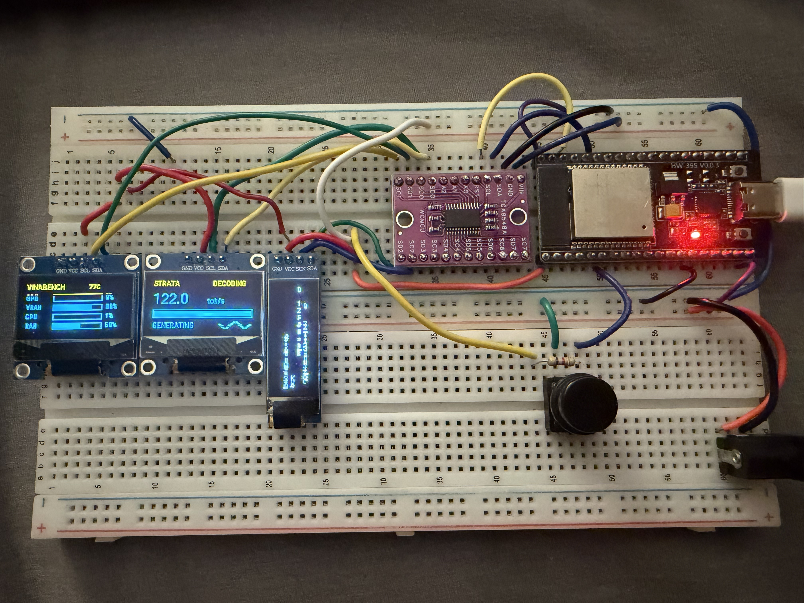

# omakase (お任せ)

**Self-hosted AI, embedded voice, and home automation.**

Omakase is an independent engineering project connecting locally hosted language models, Home Assistant, ESPHome voice hardware, and physical dashboards.

> **Work in progress, always expanding.** Omakase is an ongoing home-lab project. I continually add hardware, services, interfaces, experiments, and improvements as I learn and build. Not every component is finished or production-ready.

### Purpose of this repository

This repository is **not designed for direct cloning or one-click deployment**. My installation depends on custom hardware, private infrastructure, and configuration specific to my environment.

Instead, Omakase is a public engineering notebook: a place to **document and publish workflows, technical solutions, hardware and wiring diagrams, sanitized configuration examples, selected source code, and lessons learned**. The goal is to share reusable approaches and explain how the parts fit together, while keeping private credentials and deployment details out of GitHub.

## Architecture

```text
                  Spoken request: "Okay Nabu..."
                              |
                 ESP32-WROOM-32 voice node
             INMP441 microphone / MAX98357A
                              |
             On-device TFLite Micro wake word
                     (ESPHome microWakeWord)
                              |
              Home Assistant Assist pipeline
                STT -> conversation -> TTS
                              |
                 Home Assistant automations
                              |
                 Connected devices and UI

        Local Qwen GPU inference <-- AI integration
        Wall dashboard / OLED  <-- Monitoring & controls
```

The wake word is detected **on the ESP32**. Home Assistant handles the speech pipeline after detection; locally deployed Qwen models can serve the conversation stage when configured in the private installation.

## ESPHome voice firmware

**[ESP32 voice-node firmware](esphome/omakase-voice.yaml)** · **[Wiring, model, setup, and limitations](esphome/README.md)**

The published ESPHome YAML is based on the voice prototype's documented pinout:
- ESP32-WROOM-32
- INMP441 I²S microphone (left channel)
- MAX98357A I²S amplifier
- Built-in `okay_nabu` microWakeWord model (**TensorFlow Lite Micro**)

The YAML uses ESPHome's official model reference; the TFLite model is resolved during the ESPHome build, so no separately committed `.tflite` blob is necessary.

**Status:** Wake-word detection was observed in device logs. Full post-wake speech capture, response playback, and shared-I²S behavior still require repeatable validation on the deployed device. The example here is **not claimed to be a compiled or hardware-tested release**.

## Hardware and interaction

- Home Assistant OS on a Raspberry Pi 5
- ESP32 voice node with an I²S microphone and audio amplifier
- Local Qwen inference on NVIDIA GPU systems
- Touch-accessible wall dashboards and experimental ESPHome OLED status visualization
- Private service networking and automation workflows

### Strata inference status display



*Physical ESPHome-driven OLED monitor for Strata, my local AI inference service.*

This display gives me an at-a-glance view of whether Strata is idle or actively working, **which inference phase it is in** (such as prefill, thinking, or decoding/generation), and **generation speed in tokens per second**. It also visualizes prefill progress. Strata status and throughput are fed through Home Assistant sensors to the embedded display.

The evolving OLED configuration also explores additional pages for workstation and NAS telemetry. This is an example of the kind of hardware integration and interface work documented here, not a standalone plug-and-play product.

### More hardware and dashboard photos

Additional wall-display, voice-node, and dashboard photos will be added as they are documented and checked for sensitive details.

## Engineering focus

- Deploying models through OpenAI-compatible local APIs
- Bridging embedded voice input, speech services, and automation actions
- Building usable human-facing data and control displays
- Diagnosing failures between wake-word detection, audio capture, STT, inference, and device control
- Protecting private credentials when publishing reproducible examples

## Project status

| Area | Status |
| --- | --- |
| Home Assistant dashboards and automation | In use |
| Local model hosting | In use |
| `okay_nabu` on-device wake-word detection | Demonstrated |
| Reliable speech capture after wake word | In progress |
| End-to-end voice testing and latency measurements | Planned |
| OLED AI telemetry | Experimental |

## Security and reproducibility

This project depends on hardware, local infrastructure, and private settings. To run the voice-node example, create a private ESPHome `secrets.yaml` using [the example names](esphome/secrets.example.yaml), configure Home Assistant Assist, validate, then flash your own board.

**Never commit** Wi-Fi credentials, API encryption keys, access tokens, live device databases, or raw Home Assistant configuration.

See the [ESPHome documentation](https://esphome.io/components/micro_wake_word/) for the official wake-word implementation.